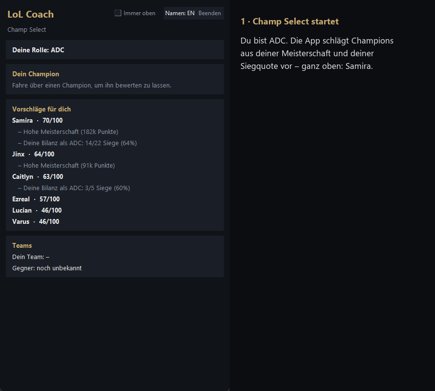

# LoL Coach

A personal desktop coaching tool for League of Legends, built as a hobby project alongside my
**AI Solutions** studies. The long-term goal is a small, self-built AI agent whose mission is to
help me improve at the game.

> **Personal use only.** This tool is not distributed. It only uses officially supported Riot data
> sources and follows the [Riot Developer Policies](https://developer.riotgames.com/policies/general).



## Features (current)

**Champ select**
- Rates the champion you are hovering (good / okay / bad) with reasons.
- Suggests picks based on your mastery, your win rate per role and team composition
  (AD/AP balance, frontline, crowd control).

**In game (static build help, like common build tools)**
- Item build plan with exactly 6 slots, based on Riot's own per-champion item recommendations
  from the game data. Champions without their own list borrow from similar champions.
- "Buy now" list for your current gold, boots timing, owned components shown under the item
  they belong to.
- Enemy list with a strength bar (K/D/A, level, item gold), reorderable by drag and drop.
- Item and champion names in English or German.

## What this tool does NOT do

- No tracking of enemy positions, jungle pathing or enemy cooldowns.
- No hidden information and no "do X now" instructions during a game.
- The Riot API key is **never** used during a game, only for offline analysis and post-game reviews.

## Roadmap

1. **Post-game review** of my own matches via the Riot API (match timelines): recall timing and
   unspent gold, deaths before objectives, objective control, comparison with high-elo players.
2. **Own build model**: learn item build orders per champion from high-elo match timelines
   (purchase events + game state, weighted by wins), retrained every patch.
3. **Local coaching agent** that explains the model's suggestions in plain language,
   running fully on my own PC.

## Data sources

| Source | Used for |
|---|---|
| League Client API (local) | Champ select, mastery, match history |
| Live Client Data API (`127.0.0.1:2999`, local) | Own game state for build suggestions |
| Data Dragon / CommunityDragon | Champion and item data, Riot's item recommendations |
| Riot API (planned) | Offline: high-elo timelines, post-game reviews |

## Setup

Requires Windows, Python 3.10+.

```powershell
pip install -r requirements.txt
python main.py                    # open the window
python install_autostart.py       # start with Windows, window opens when League starts
python install_autostart.py --remove
```

For the planned Riot API features, the key is read from the `RIOT_API_KEY` environment variable
and is never stored in the repository.

Run the game in **borderless** mode (or use a second monitor) so the window can stay on top.

## Tests and demo

```powershell
python tests/smoke_test.py        # simulated games with real patch data
python demo/make_demo.py          # records demo/demo.gif from the real UI (needs pillow)
```
